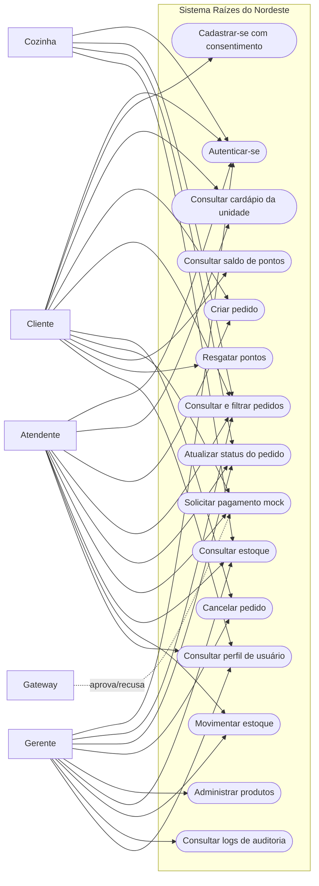

# Diagrama de casos de uso

Atores do sistema, conforme o roteiro da trilha:

- **Cliente** — pede pelo App, Totem ou Web e acompanha o status; participante do programa de fidelidade (se consentiu).
- **Atendente (Balcão)** — registra pedidos de balcão/pickup, movimenta estoque e entrega.
- **Cozinha** — inicia a preparação e marca o pedido como pronto.
- **Gerente / Administrador** — administra produtos, unidades e usuários, consulta logs e faz qualquer operação operacional.
- **Sistema Externo de Pagamento (Gateway)** — ator secundário, simulado por mock; aprova ou recusa.

## Feature crítica: Realizar Pedido + Solicitar Pagamento

- **Ator principal:** Cliente (App/Totem/Web) ou Atendente (Balcão/Pickup).
- **Pré-condições:** produtos cadastrados com estoque na unidade; cliente autenticado (perfil CLIENTE ou ATENDENTE).
- **Fluxo principal:**
  1. O ator escolhe a unidade e consulta o cardápio (GET /produtos?unidadeId=).
  2. O ator envia o pedido com `unidadeId`, `itens` (produtoId + quantidade), `canalPedido` e `formaPagamento` (POST /pedidos).
  3. A API valida unidade, produtos, disponibilidade e saldo de estoque (regras RN02–RN04).
  4. A API calcula o total no servidor, congela os preços nos itens, baixa o estoque e grava o pedido com status AGUARDANDO_PAGAMENTO, registrando o canal (RF08) e o log de auditoria.
  5. O ator solicita o pagamento (POST /pagamentos com pedidoId e formaPagamento).
  6. O gateway mock decide (RN07) e a API registra o resultado.
  7. Aprovado: pedido passa a EM_PREPARO e o cliente acumula pontos (RN08); recusado: pedido permanece AGUARDANDO_PAGAMENTO com o registro da recusa.
- **Pós-condições:** pedido persistido com itens, pagamento registrado, estoque atualizado, log de auditoria criado.
- **Exceções:** unidade/produto inexistente (404), estoque insuficiente (409, com quantidade disponível no detalhe), produto indisponível (409), canal ausente/inválido (422), pagamento de pedido não pendente (409), pedido inexistente (404), token ausente/inválido (401), perfil sem permissão (403).
- **Regras de negócio aplicáveis:** RN01 a RN08.
