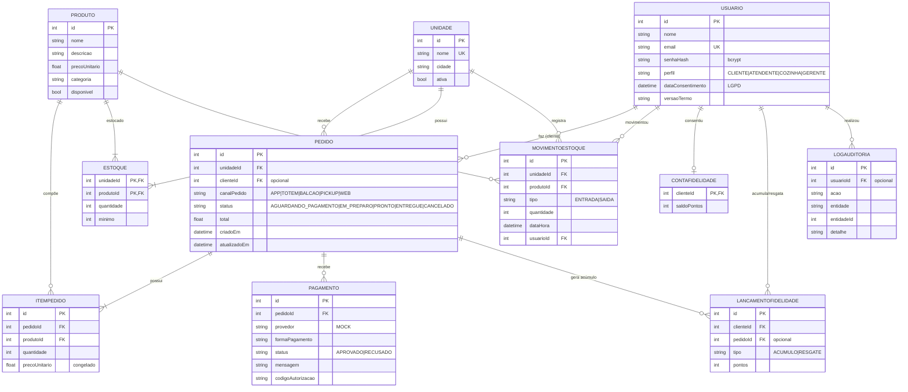

# DER — Diagrama Entidade-Relacionamento

Modelo implementado exatamente como desenhado aqui: a migration `init` do Prisma cria as mesmas tabelas, chaves e relacionamentos (`prisma/schema.prisma`). Como o SQLite do Prisma não suporta ENUM, os campos de enumeração (`perfil`, `canalPedido`, `status`, `tipo`) ficam como `String` e são validados na camada de domínio.

## Decisões de modelagem

- **Estoque é por unidade** (tabela associativa `Estoque` com chave composta) — atende ao cenário em que unidades têm cardápio e estoque próprios.
- **Pagamento é desacoplado do pedido** (tabela própria, um pedido pode ter mais de uma tentativa) — reflete a arquitetura com gateway externo simulado.
- **Preço é congelado no `ItemPedido`** — mudanças futuras de preço não reescrevem o histórico.
- **`clienteId` em Pedido é opcional** — pedidos de balcão podem ser feitos sem cliente cadastrado; fidelidade só existe com cliente identificado e consentimento registrado.
- **LogAuditoria é genérico** (entidade + entidadeId) — cobre pedido, status, estoque, pagamento, fidelidade e acesso a dados pessoais sem criar uma tabela por tipo de log.
